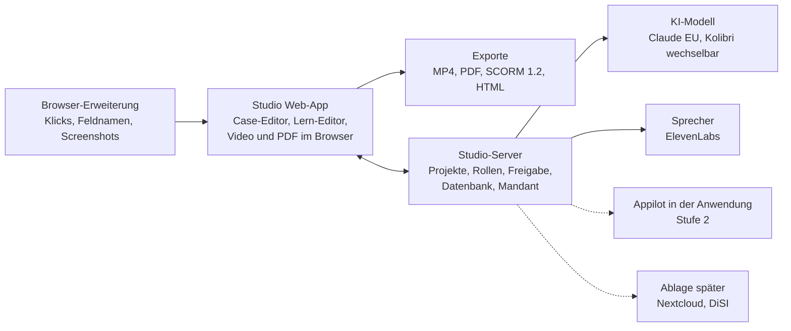

# Appilot Studio – Produktkonzept

Stand: 5. November 2026 · Entwurf · Online-Fassung: https://claude.ai/artifact/PG15P9WUt54e9hZeHUnbwv
(ab jetzt ist diese Datei im Repo die maßgebliche Fassung)

## Kurzfassung

Der Lern-, Video- und Klickanleitungs-Editor aus der MVDemo wird zu einem eigenständigen Autorentool mit Appilot als
KI-Hilfe beim Erstellen. Arbeitstitel: **Appilot Studio**.

- **Entschieden:** eigenständiges Produkt, keine Anbindung an die bk Workbench. Das Studio funktioniert ohne Appilot in
  der Zielanwendung und wird mit ihm deutlich stärker.
- **Später optional:** Nextcloud-Integration und Ablage der erzeugten Lernstrecken auf DiSI.
- **Ziel:** vorführbarer MVP zur LEARNTEC Anfang Februar 2027.
- **Rechte:** Aus MV gibt es keine Zusage und keine Nutzungsrechte; der Code gehört vollständig der bk.

## Ausgangslage

Übernommen aus der MVDemo (Stand PR #17) mit PR #1 dieses Repos:

| Funktion | Stand |
| --- | --- |
| Case-Editor: Ablauf beschreiben (KI-Entwurf) oder aufnehmen, Probelauf, Fehlerbilder | übernommen |
| Schulungsvideo als MP4 mit ElevenLabs-Sprecher, im Browser gerendert | übernommen |
| Klickanleitung, druckbar als PDF | übernommen |
| Lern-Editor mit 9 Bausteintypen, didaktischem Gerüst und Prüfregeln | übernommen |
| KI-Entwurf einer Lernstrecke aus Thema und Quellen, Tutor beim Lernen | übernommen |
| Erklärvideo aus jedem Erklärungs-Baustein | übernommen |
| Freigabe im Vier-Augen-Prinzip | übernommen (Rollen noch simuliert) |
| SCORM-1.2-Export | übernommen |
| Sprachfassungen (Deutsch, Einfache Sprache, Englisch) | übernommen |
| Update-Check: betroffene Inhalte nach einem Release der Zielanwendung erkennen | übernommen, Karte aus Anwendung oder JSON-Datei |
| Zielanwendung als Projekteinstellung | neu |

Noch offen für ein Produkt:

- **Aufnahme in fremden Anwendungen:** heute über iframe + `postMessage` (Appilot-Protokoll, siehe README). Das klappt
  nur, wenn die Zielanwendung das Appilot-Skript einbindet. Für beliebige Web-Apps braucht es die Browser-Erweiterung.
- **Screenshots** kommen heute aus dem DOM (`html-to-image`), künftig über die Tab-Aufnahme der Erweiterung.
- **Speicher** liegt nur im Browser (IndexedDB). Es braucht Server, Datenbank, Benutzer, Rollen, einen Mandanten.

## Positionierung und Zielgruppe

**„Aus einem Klickablauf werden in Minuten Video, Anleitung und Lernstrecke – mit KI, die die Anwendung versteht,
betreibbar on-prem oder in der EU.“**

1. Fachbereiche und Schulungsteams in Verwaltungen und bei IT-Dienstleistern der öffentlichen Hand
   (Einführung/Umstellung von Fachverfahren wie HKR, E-Akte, SAP Fiori).
2. L&D- und Onboarding-Teams im Mittelstand, die Software-Schulungen selbst produzieren.
3. Partner und Systemhäuser (z. B. SVA), die das Studio bei Einführungsprojekten mitliefern.

| Kategorie | Beispiele | Unser Unterschied |
| --- | --- | --- |
| Klickanleitungs-Recorder | Scribe, Tango | Video mit Sprecher, Lernstrecke und SCORM aus einem Ablauf; KI versteht Masken und Felder |
| Digital Adoption Platforms | WalkMe, Whatfix, Userlane | schlanker, Autoren ohne Entwickler, on-prem/EU, Fokus Verwaltung |
| E-Learning-Autorentools | Articulate, Captivate, iSpring | Praxis in der echten Anwendung, KI-Entwurf aus Quellen, Update-Check |

Einordnung der Wettbewerber aus allgemeiner Marktkenntnis, vor Vertriebsunterlagen prüfen.

## Produktzuschnitt: Studio und Appilot

Das Studio ist das Produkt; Appilot hilft darin von Anfang an. Wird Appilot zusätzlich in der Zielanwendung
eingesetzt, kommt Stufe 2 dazu.

| Funktion | Studio (Basis) | + Appilot in der Anwendung |
| --- | --- | --- |
| Ablauf in beliebiger Web-App aufnehmen (Browser-Erweiterung) | ja | ja |
| Schritt-Texte von der KI formulieren | ja | ja |
| Video mit Sprecher, Klickanleitung als PDF | ja | ja |
| Lern-Editor, didaktisches Gerüst, KI-Entwurf aus Thema und Quellen | ja | ja |
| Übersetzung, Einfache Sprache | ja | ja |
| Freigabe im Vier-Augen-Prinzip | ja | ja |
| Export: MP4, PDF, SCORM 1.2, HTML-Paket | ja | ja |
| Update-Check mit Karte aus JSON-Datei | ja | ja |
| Ablauf nur beschreiben, KI liest die Anwendung und entwirft die Schritte | nein | ja |
| Probelauf: Appilot spielt den Ablauf in der Anwendung ab | nein | ja |
| Praxisaufgabe als geführter Case in der echten Anwendung | nein | ja |
| Update-Check mit Karte live aus der Anwendung | nein | ja |
| Kontexthilfe und Chat in der Anwendung, gespeist aus dem Studio | nein | ja |

Der Feedback-Kanal aus der MVDemo gehört zum Appilot in der Anwendung, nicht ins Studio.

## MVP für die LEARNTEC

Vorführung: Ein Besucher nennt eine Web-Anwendung, wir nehmen einen Ablauf auf, nach wenigen Minuten gibt es Video,
Anleitung und Lernstrecke als SCORM. Aufgaben und Status: siehe `docs/plan.md`.

Nicht im MVP: Appilot in der Anwendung (nur als Ausblick in der Beispielanwendung), Nextcloud und DiSI, Abrechnung,
mehrere Mandanten, SCORM 2004 und xAPI.

## Architektur

Gestrichelt: nach dem MVP. Die Browser-Erweiterung spricht das bestehende Appilot-Protokoll (README), damit
Aufnahme, Probelauf, Bildschirmfotos und Karte für Studio und Erweiterung gleich bleiben. Vorlage: die
Live-Check-Erweiterung aus `Mhalb/appilot2`.

## Roadmap (Vorschlag, nur LEARNTEC fest)

| Phase | Zeitraum | Inhalt |
| --- | --- | --- |
| Herauslösen | Nov–Dez 2026 | Repo, Code übernehmen, Server, Browser-Erweiterung |
| MVP fertig | Jan 2027 | Freigabe und Rollen, Beispielanwendung, Testläufe im Team |
| **Gate LEARNTEC** | Anfang Feb 2027 | Kriterium: Ablauf live aufnehmen, Video und SCORM in Minuten |
| Stufe 2 und Pilot | Q2 2027 | Appilot in der Anwendung, erste Pilotkunden |
| Ausbau | H2 2027 | Nextcloud, Ablage auf DiSI, Mandanten, SCORM 2004, xAPI |

## Offene Fragen

- Name und Marke („Appilot Studio“ ist Arbeitstitel)
- Preismodell: pro Autor, pro Mandant oder pro Lernendem; On-prem-Lizenz
- Betrieb des MVP: Vercel (heute), eigene Cloud oder on-prem-fähiger Container
- Rechte der Browser-Erweiterung, abgestimmt mit dem Security Framework
- Ressourcen neben Workbench und DiSI MV
- Beispielanwendung und Beispielablauf für die Messe
